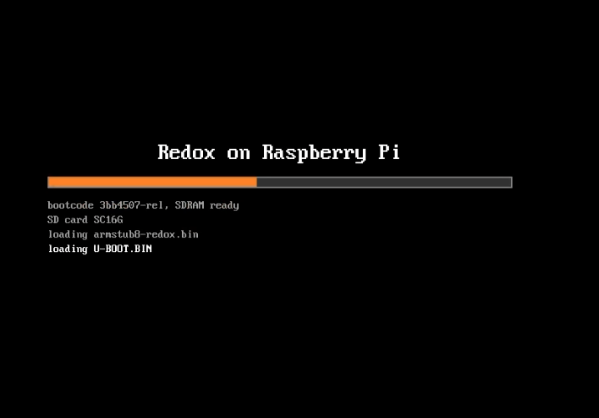
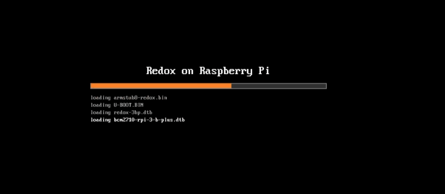
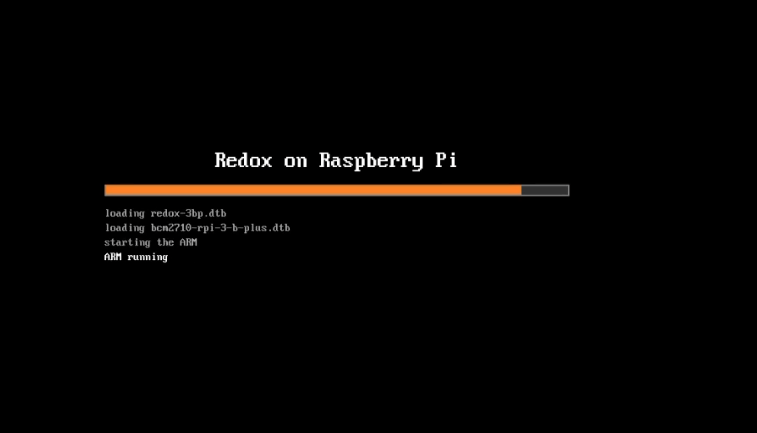
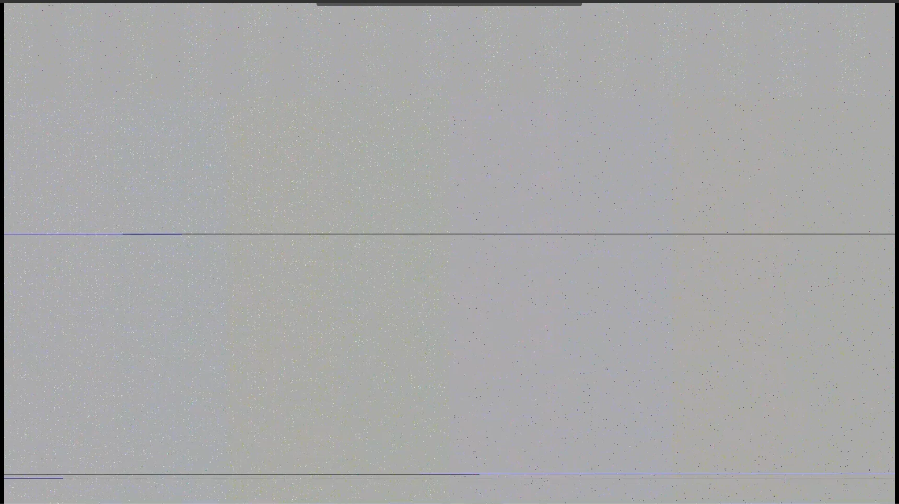

# 447: HDMI framebuffer and boot screen on the NanoKVM, Pi 3B+ (person test, rof #20, #21, PRs #15 and #16)

**Result: pass.** A1–A3 and the boot screen in B look as described; the maintainer watched on the NanoKVM, and the boot screen is also in a screen recording (three frames below). Information only: after the handover, the screen shows grey noise with thin stripes through U-Boot and Redox, nothing readable.

- Pi 3B+, selector card in (no card swap), payloads chained over serial as in rows 429–445 (`~/rbc-build/bootcode-sd/rbc-load.sh --enter … c1000000 chainmon`), power cycles over the Shelly plug. The maintainer at the NanoKVM; I typed on the serial console. 2026-11-16, 16:31–16:44 UTC.
- A: `bootcode-bs-20261115b.bin`, sha256 `65e5a8f05d4c7d89…`, banner `redox-rpi bootcode 3bb4507 (M1, monitor, test build)` after the selector's `233c8c5-bootsel`.
- B: `bootcode-bsrel-20261115b.bin`, sha256 `2015f6add8a00190…`, banner `redox-rpi bootcode 3bb4507-rel (release, boots from the SD card, boot screen on HDMI)`.

### A) monitor payload

| Step | Serial | Maintainer on the NanoKVM |
|---|---|---|
| 1 `fb 780 438 20 1` | `ok fb 1920x1080 32 bit RGB at FE400000 pitch 7680, pattern readback ok, crc32 E5E7C3AA` | "ja, 8 Balken mit weißem Rand" (asked about the order white–yellow–cyan–green–magenta–red–blue–black and the border) |
| 2 `fb 400 300 10 0` | `ok fb 1024x768 16 bit BGR at FE400000 pitch 2048, pattern readback ok, crc32 8801DC75` | "ja, kleiner und mittig, Farben gleich" (red and blue not swapped) |
| 3 `bs` | `ok bs 640x160 16 bit at FE000000, crc32 01D9B6D3, HDMI start 224927 us, drawing 22102 us` | "ja, scharf und lesbar, Farben stimmen, kein Flackern". Whether anything was cut off or shifted was asked but not answered separately; the B frames below show the same panel uncut and centred |

### B) release payload with the boot screen

Two power cycles, both the same on serial:

| | firmware banner | `ok boot64` | `bootscreen: handed over …` |
|---|---|---|---|
| B (16:35) | 16:35:28.818 | 16:35:30.505 | 16:35:30.952: `handed over to the ARM's framebuffer 2097 ms after it came up; HDMI start 1298 us, drawing 16524 us` |
| B2 (16:42) | 16:42:47.845 | 16:42:49.531 | 16:42:49.979: `… 2097 ms after it came up; HDMI start 1299 us, drawing 16527 us` |

(`rbc-load … timeout waiting for: rbc> monitor` is expected: a release build opens no monitor.)

- First boot: the maintainer saw the boot screen ("the boot was ok … quite fast", "yes bar was good").
- Second boot: the maintainer made a screen recording. Three frames show the orange bar growing and the lines in order: `bootcode 3bb4507-rel, SDRAM ready`, `SD card SC16G`, `loading armstub8-redox.bin`, `loading U-BOOT.BIN`, `loading redox-3bp.dtb`, **`loading bcm2710-rpi-3-b-plus.dtb`** (not in the row's list), `starting the ARM`, `ARM running`. The list scrolls: four lines are shown at a time, the newest in white, older ones in grey.

### After the handover (information only)

U-Boot's console is on HDMI (`Out: serial,vidconsole`), but the screen shows a grey, noisy picture with a few thin horizontal lines (partly blue), no text. It stayed like that while Redox booted (`fbbootlogd: mapped display` on serial) and at `redox login:` ("immer noch grau mit Streifen"). So neither U-Boot nor Redox draws readable output into our framebuffer yet.

### Afterwards

U-Boot autobooted its default `redox/`, the stable image `v0.5.1-dev-101-g000f605e+x2d42` (tonight's nightly), `redox login:` on serial; nothing to restore. The selector card stays in.

Files on <build host>: `~/pitest-tools/t447/` (events.txt, monitor.txt, load*.txt, B-ts.log, B2-ts.log with host timestamps, the frames and the screenshot).
