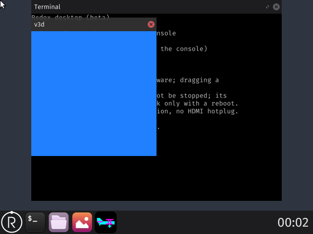

# 556: V3D step 2c, early: the GPU's picture on the screen (Pi 400)

**Result: pass.** The GPU rendered the 256x256 picture (`render: PASS`), and v3dprobe showed it: `show: the picture is in an Orbital window (256x256 at 64,64) for 40 s`. On the screen it is a window titled "v3d" at 64,64. The 256x256 content is all **R 0x20 G 0x80 B 0xff** (light blue). The pixel at 192,192 is `2080ff`. 40 s later the window is gone.



- Pi 400, network boot, no person. 2026-11-20; run 5 at 21:57–22:03 UTC.
- Image `keep/gfx-v3dshow-netboot/` (img.gz `4ccb7863…`, manifest `8851e00a…`), banner `v0.6.0-dev-174-g0d414d46+xa6ac (netboot)`.
- config.txt as Tests 552–555.

## What happened

| Step | Result |
|---|---|
| desktop | `desktop --yes; sleep 25`: orbital and orblogin running |
| (1) login | `pointer-bench --keys enter; sleep 8` |
| (2) `v3dprobe --render --show 40 > /tmp/v3d.log &`, `sleep 6; vc4shot /tmp/v3d.ppm` | vc4shot: 2 planes. **65536 pixels are 0x2080ff, in the box x 64..319, y 64..319**, which is exactly 256x256 at 64,64 |
| v3dprobe lines | `render: PASS: 256x256 cleared to 0xffff8020 by bin and render control lists`; `show: the picture is in an Orbital window (256x256 at 64,64) for 40 s` |
| (4) after 40 s: `vc4shot /tmp/after.ppm` | **0 pixels 0x2080ff**: the window is gone |

- The window's title bar ("v3d") sits above the content, at y about 38–63. The content starts at 64,64, not 64 plus the title bar.
- The pictures: `556/v3d.ppm` and `v3d.png` (with the window), `556/after.ppm` and `after.png` (without it).
- devsh still answers afterwards.

## Panic lines: usbhubd at boot, not V3D

The serial log has 2 `panic`/`UNHANDLED` lines, both from **usbhubd at boot**, before the test. The USB mouse on port 1.2 failed to attach:

```
xhcid: Failed to address device at slot 2 (port 1.2), completion code 0x4
thread 'main' (1) panicked at drivers/usb/usbhubd/src/main.rs:136:22: Failed to attach: IoError(… I/O error)
UNHANDLED EXCEPTION … NAME /usr/lib/drivers/usbhubd
```

- This happened on every boot of this image with the mouse plugged in.
- The row 501 restore image did the same.
- It is fixed in main by #590 (the usbhubd fix); this image is older.
- V3D and Orbital were not affected. Pointer input came from pointer-bench.

## Runs 1–4 (my side, no result)

1. My script read its arguments too late and stopped before any step.
2. Ion rejected `2>&1`.
3. The script stopped at the usbhubd fault during boot.
4. Orbital was not started. The row's step (1) assumes the desktop is running; desktop-check runs `desktop --yes` first. `render: PASS` already showed, but there was no window (`show: cannot open an Orbital window`).

## Against the pass criteria

| Criterion | Result |
|---|---|
| `render: PASS` and `show: the picture is in an Orbital window` | **yes** |
| window at about 64,64, 256x256 content one colour R 0x20 G 0x80 B 0xff; centre pixel | **yes**: 65536 px at 64..319; (192,192) = `2080ff` |
| after.ppm without the window | **yes**: 0 such pixels |
| no panic | **no V3D or Orbital panic**; 1 usbhubd panic at boot (mouse attach, fixed by #590) |

## Afterwards

config.txt restored (same), row 501's image staged and booted to `redox login:` (its usbhubd also panicked on the mouse, as before).

Script `~/pitest-tools/run556.sh` and `t556.py`.
