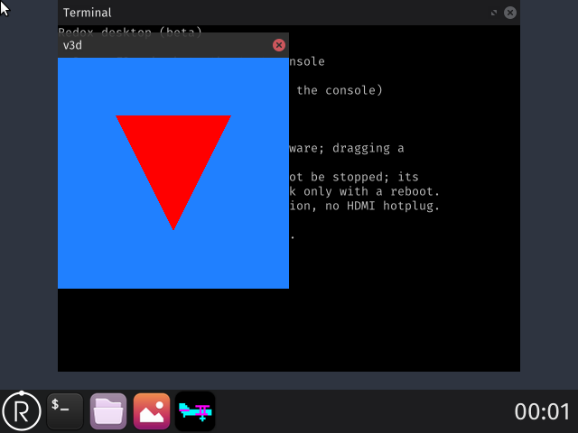

# 557: V3D step 2b, the first triangle drawn by the GPU's QPUs (Pi 400)

**Result: pass.** Step 2 (clear) prints `render: PASS`. Step 3 prints `render: PASS: a red triangle on 0xffff8020, drawn by the QPUs through bin and render control lists`, and tri.png shows the "v3d" window at 64,64 with a red triangle on light blue. Step 4 (`--triangle-math`) passes too. There was no panic, and no usbhubd fault this time (#590 is in the image).



- Pi 400, network boot, no person. 2026-11-20, 22:03–22:08 UTC.
- Image `keep/gfx-v3dtri2-netboot/` (img.gz `54fb73c1…`, manifest `04ae08ec…`), banner `v0.6.0-dev-177-ge66383bd+xa6ac (netboot)`. 0 U-Boot retries.
- config.txt as Tests 552–556.
- The desktop was started first with `desktop --yes; sleep 25`, as desktop-check does (orbital and orblogin running). Then the login with `pointer-bench --keys enter; sleep 8`.

## Results

| Step | Result |
|---|---|
| (2) `v3dprobe --render --off` | `render: PASS: 256x256 cleared to 0xffff8020`; 65536 of 65536 px; bin 4 us, render 47 us |
| (3) `--render --triangle --show 40 --off` | **PASS**: `triangle: 8192 red, 57344 clear, 0 other pixels (area 8192 expected red); base at row 64; centre 0xff0000ff; 0 wrong away from the edges`; bin 11 us, render 53 us; `show: … Orbital window (256x256 at 64,64) for 40 s` |
| (4) `--render --triangle-math --show 40 --off` | **PASS**: the same counts and picture; bin 10 us, render 53 us |

**On the screen** (vc4shot, 640x480, 2 planes), the same in tri.ppm and tri-math.ppm:
- 57344 px light blue `2080ff` in the box 64..319 x 64..319, i.e. the 256x256 window content at 64,64;
- **8192 red px**, x 128..255, y 128..254:
  - top row (y 128): x 128..255;
  - middle (y 191): x 160..223;
  - tip (y 254): x 191..192.
- In content coordinates this is a triangle with corners about **64,64 / 192,64 / 128,192**, point down (the "upside down" case of the criteria).

Coarse picture from v3dprobe (step 3, same in step 4):

```
|........###############.........|
|.........#############..........|
|..........###########...........|
|...........#########............|
|............#######.............|
|.............#####..............|
|..............###...............|
|...............#................|
```

- CT0CA 0x10006c, CT1CA 0x101097, BFC/RFC 1/1, CTL_INT_STS 0xb.
- `watchdog stopped (PM_RSTC 0x102)` after the jobs. With `--off`, it closes both bridges, asserts the reset, and logs `v3d_power off: off, PM_GRAFX 0x1000`.
- No `NOT done`, no watchdog reset (one boot in the serial log), 0 `panic`/`UNHANDLED`. devsh still answers.

## Against the pass criteria

| Criterion | Result |
|---|---|
| step 2 `render: PASS` | **yes** |
| step 3 `render: PASS: a red triangle`; window at about 64,64; red triangle 64,64/192,64/128,192 (or upside down) on 2080ff | **yes**, upside down |
| step 4 (extra) | **PASS** |
| no panic | **yes** |

## Afterwards

config.txt restored (same), row 501's image staged and booted to `redox login:`.

Files: `reports/557/` (tri.ppm/png, tri-math.ppm/png, all output). Script `~/pitest-tools/run557.sh`, `t557.py`.
