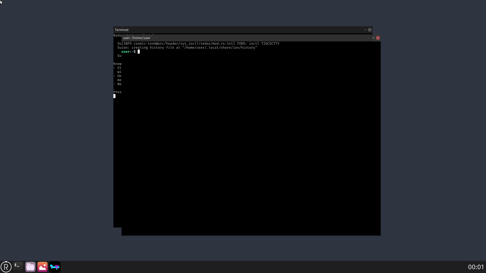

# Test 649 – Pi 400 graphics G4 step 3: Orbital compositing on the GPU vs the CPU at 1080p (#670)

Date: 2026-11-25, 07:41–07:50 UTC. Pi test agent. Pi 400, network boot, HDMI on the NanoKVM, no person. config.txt as in Test 636 run B (Test 604 plus `hdmi_group=1`, `hdmi_mode=16`, 1920x1080), restored afterwards. Image `keep/gfx-g4l-netboot/` `v0.7.0-dev-85-gc8b20ed0+x1d65`: img.gz sha256 `802667cf3a87c008…` and manifest `14bc8c85fcc1973f…` both match the row. Experiments include `orbital-gl`.

Result: **pass, with one deviation.**
- Both runs completed steps 1–3.
- **While a window is dragged, Orbital needs 16.8 % of a core on the GPU path and 80.5 % on the CPU path.** On the GPU path, v3dd adds 14.5 % and vc4d 6.2 %. Together, Orbital, v3dd and vc4d use 37.5 % on the GPU path and 83.1 % on the CPU path.
- The two desktops look the same: screenshots differ only by 1–3 colour levels in about 6 % of the pixels, with nothing visibly wrong.
- No crash, no reset, no panic.
- **Deviation:** `/tmp/desktop.log` has neither the expected `GL compositing on the GPU` line (run G) nor `GL compositing switched off` (run C). Other signs show which path ran; see step 1.

## Step 1 – desktop and log

- Both runs: `desktop --yes`, `pointer-bench --type user`, three Enters (as in Test 636). Run C ran `export ORBITAL_GL=0` in the same command line. `echo $ORBITAL_GL` printed `ORBITAL_GL=0` in run C. In run G the variable did not exist.
- `grep -E 'GL|ERROR' /tmp/desktop.log`:
  - Run G: only `libEGL warning: MESA-LOADER: failed to retrieve device information`.
  - Run C: nothing.
  - **No `GL compositing …` line in either run, and no ERROR line.**
- Run G did draw through the GPU:
  - Orbital logs `TODO: unimplemented DRM ioctl(11, 0xc1, …)` lines; all 40 lines of the log tail are these. Run C has none.
  - Serial shows a v3dd import in run G only.
  - At the end, v3dd has 24.7 MB and 5.7 s of CPU time in run G, against 11.9 MB and 0.1 s in run C.
  - Orbital's memory is 49.5 MB in run G and 24.7 MB in run C.

## Step 2 / step 3 – CPU during a 30 s window drag (1920x1080, `ps` time deltas over 10.3 s, % of one core)

| Process | run G (GPU) | run C (CPU, `ORBITAL_GL=0`) |
|---|---|---|
| **orbital** | **16.8** | **80.5** |
| **v3dd** | **14.5** | 0.0 |
| **vc4d** | **6.2** | 2.6 |
| orbital + v3dd + vc4d | 37.5 | 83.1 |
| usbhidd | 22.1 | 21.3 |
| xhcid | 9.2 | 13.5 |
| top others | redoxfs 0.9, netstack 0.3, inputd 0.3 | cosmic-term 0.6, netstack 0.5, redoxfs 0.4 |
| pointer-bench | `1800 moves in 30.1 s (59.8/s), dragging` | `1800 moves in 30.1 s (59.8/s), dragging` |

- usbhidd and xhcid are high in both runs (21–22 % and 9–14 %). This image does not have Test 645's base patch 0125 (idle rate 0); that patch took usbhidd to 0.0 % at idle.
- In run C, opening the terminal (`pointer-bench --super t`) took 5.3 s; in run G it took 0.5 s.

## Screenshots

Run G and run C: the terminal 5 s after opening ([G](649/G/term.png), [C](649/C/term.png)) and right after the drag ([G](649/G/after.png), [C](649/C/after.png)).
- Both show the same desktop:
  - the background,
  - the old "Terminal" window with its title bar,
  - the cosmic-term window `user: /home/user` with title bar, close button, prompt and text,
  - the launcher bar with its icons,
  - the clock and the cursor.
- **Pixel compare G vs C:**
  - Opening shot: 122,005 of 2,073,600 pixels differ, at most 2 levels per channel (120,324 by 1, 1,681 by 2).
  - After the drag: 121,924 differ, at most 3 levels (one pixel).
  - All differences are below the top bar (from y = 104), in the window areas. This looks like rounding in GPU blending. I see no wrong colours, missing title or stale areas.
- The drag circles around the centre and ends where it started, so both "after" shots show the window in the same place.

## Errors and restore

- No reboot after login in either run, `panic`/`UNHANDLED` 0, devsh still answered after the steps. Orbital did not crash.
- Afterwards:
  - config.txt restored (byte-identical).
  - Row 501's image staged and booted to `redox login:` (07:49).

Files: [649/](649/) (events; per run: step output with `ps` and the desktop.log tail, boot log, screenshots).
