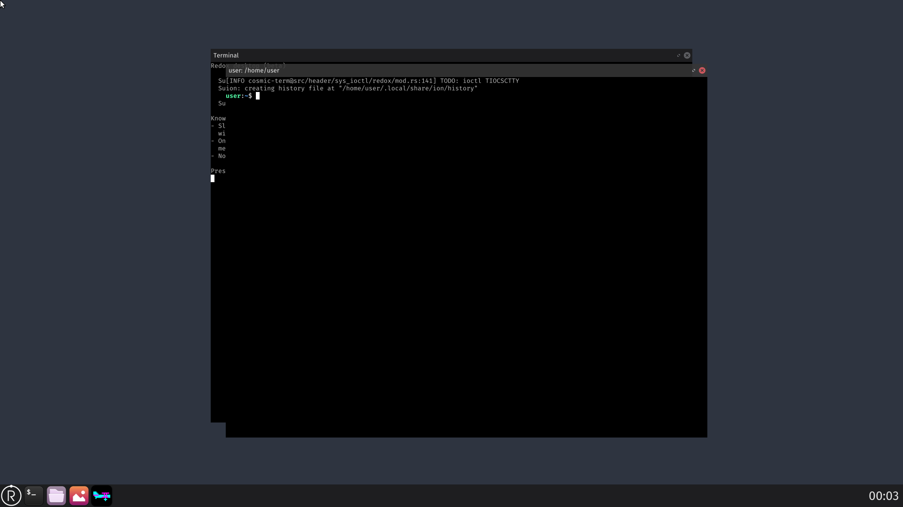

# Test 651 – Pi 400 graphics G4 step 3, second run of Orbital on the GPU, 1080p (#670, PR #733)

Date: 2026-11-25, 08:02–08:19 UTC. Pi test agent. Pi 400, network boot, HDMI on the NanoKVM, no person. config.txt as in Test 649 (1920x1080), restored afterwards. Image `keep/gfx-g4m-netboot/` `v0.7.0-dev-87-gd7d41a7c+x1d65`: img.gz sha256 `6aa286e0e9824bdb…` and manifest `4ea255212101593e…` both match the row.

Result: **pass.**
- Step 1 now shows the expected line in both runs.
- While a window is dragged, Orbital needs **11.9 %** of a core on the GPU path (Test 649: 16.8 %) and 80.6 % on the CPU path.
- The screenshots of both paths match up to 1–3 colour levels.
- **Opening and closing 5 terminals does not leak GPU memory:** v3dd ends 6 MB *below* its first value, 18.6 MB against 24.6 MB.
- No crash, no reset, no panic.

## Step 1 – desktop and log

- Run G: `/tmp/desktop.log` has **`[orbital@orbital::compositor::gl:367 WARN] GL compositing on the GPU`** ✔, plus the known `libEGL warning: MESA-LOADER: failed to retrieve device information`.
- Run C (`export ORBITAL_GL=0`, and `echo` showed `ORBITAL_GL=0`): **`[orbital@orbital::compositor::gl:362 WARN] GL compositing switched off (ORBITAL_GL=0)`** ✔.
- No ERROR line in either run.

## Step 3 – CPU during a 30 s window drag (1920x1080, `ps` time deltas over 10.3 s, % of one core)

| Process | run G (GPU) | run C (CPU) | Test 649 G | Test 649 C |
|---|---|---|---|---|
| **orbital** | **11.9** | **80.6** | 16.8 | 80.5 |
| **v3dd** | **18.2** | 0.0 | 14.5 | 0.0 |
| **vc4d** | < 0.5 (not in the top 8) | 1.0 | 6.2 | 2.6 |
| orbital + v3dd + vc4d | about 30.5 | 81.6 | 37.5 | 83.1 |
| usbhidd / xhcid | 21.5 / 13.2 | 20.4 / 12.2 | 22.1 / 9.2 | 21.3 / 13.5 |
| top others | redoxfs 0.6, netstack 0.5, pointer-bench 0.5 | cosmic-term 0.6, pointer-bench 0.5, inputd | | |
| pointer-bench | `1800 moves in 30.1 s (59.8/s), dragging` | same | | |

- On the GPU path, Orbital's share is lower than in Test 649 and v3dd's a little higher. The total of the three is about 7 points lower.
- usbhidd and xhcid are as high as in Test 649. This image does not have Test 645's base patch 0125.

## Screenshots G vs C

- [G term](651/G/term.png) and [C term](651/C/term.png): 122,005 of 2,073,600 pixels differ, at most 2 levels per channel.
- [G after](651/G/after.png) and [C after](651/C/after.png): 121,924 pixels differ, at most 3 levels.
- These are the same counts as in Test 649, all in the window areas, and look like blend rounding.
- Both show the background, the "Terminal" window and the cosmic-term window with title bars and text, the launcher bar, the clock and the cursor. **I see no difference:** no wrong colours, no missing title, no stale areas.

## Step 4 – open and close a terminal 5 times (run G)

In the first run, step 4 typed `exit` and Enter into each new terminal. The end state was right: one cosmic-term left, v3dd 24.6 → 18.6 MB, and the third screenshot pixel-identical to the one after the drag. But that run had no proof that the terminals really opened. So I **ran run G's step 4 again on the same image (08:12–08:19), with a `ps` and a `vc4shot` after each open** ([G-step4/](651/G-step4/)):

| Moment | cosmic-term processes | v3dd memory |
|---|---|---|
| before | 1 | 24.6 MB |
| open 1 / closed 1 | 2 / 1 | 27.6 / 27.6 MB |
| open 2 / closed 2 | 2 / 1 | 30.6 / 27.6 MB |
| open 3 / closed 3 | 2 / 1 | 30.6 / 27.6 MB |
| open 4 / closed 4 | 2 / 1 | 30.6 / 27.6 MB |
| open 5 / closed 5 | 2 / 1 | 30.6 / 27.6 MB |
| **10 s after the last close** | 1 | **18.6 MB** |

- Each open adds a second cosmic-term process, and v3dd grows by 3 MB. Each close removes it.
- Memory stays flat over the five rounds at 27.6 MB while windows are recently used. It drops to **18.6 MB** 10 s after the last close: textures not drawn for 5 s are deleted.
- The first run gave the same values: 24.6 → 18.6 MB.
- Screenshots:
  - [open4.png](651/G-step4/open4.png): the fifth new terminal, cascaded on top with its own title bar and prompt.
  - [after5.png](651/G-step4/after5.png): 10 s after the last close, the desktop with only the step 2 windows, **no leftover windows**.

## Errors and restore

- No reboot after login in any run (G, C, step-4 rerun), `panic`/`UNHANDLED` 0, devsh still answered. Orbital did not crash.
- Afterwards:
  - config.txt restored (byte-identical).
  - Row 501's image staged and booted to `redox login:` (08:19).
  - The boot helper reports "fault" for this image because of the known usbhubd panic with the USB mouse. The login prompt comes.

Files: [651/](651/) (events; per run: step output with `ps` and desktop.log lines, boot log, screenshots; G-step4: the step 4 rerun).
