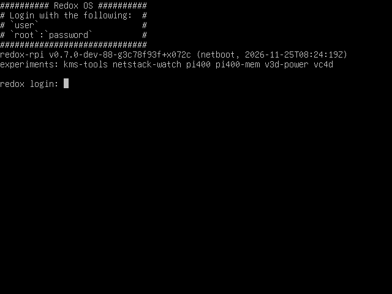

# Test 652 – libdrm's test programs and drm_info against vc4d, console without Orbital (#728)

Date: 2026-11-25, 08:29–08:46 UTC. Pi test agent. Pi 400, network boot, no person, Orbital not started. Image `keep/kms1-netboot/` `v0.7.0-dev-88-g3c78f93f+x072c`: img.gz sha256 `080590c471e75040…` and manifest `b301082d35c9f448…` both match the row. Experiments: `kms-tools netstack-watch pi400 pi400-mem v3d-power vc4d`.

Result: **pass (all four steps run and copied). The libdrm programs that open the device by name or busid do not work yet:**
- **`drm_info /dev/dri/card0` works** when vc4d drives the display. It shows the driver, its capabilities, connector 27 (connected, 640×480), encoder 26, CRTC 22 and five planes.
- **`modetest`, `proptest` and `modeprint` fail at libdrm's `drmOpen`:**
  - `failed to open device '(null)' with busid '/dev/dri/card0': Invalid argument`
  - with `-M vc4`: `… 'vc4' with busid '(null)': Bad file number`
- **So no modeset and no page flip ran** in steps 3 and 4. The screen kept showing the console.
- **libdrm fills `/dev/dri` with 63 empty files** `card1`–`card63`. Without a working display it also replaces the `card0` link with an empty file.
- **With the unchanged config.txt, vc4d drives no display at all** (`no HVS channel enabled, display left as it is`). The row's "as in Test 604" needs the two hotplug lines.
- No crash of any program, no watchdog reset, no panic.

I ran five short passes. The row's steps over devsh gave only errors, so I tried the usual variants, then the serial console as the row says, then config.txt with the Test 604 lines. Each pass is one boot of the same image; files are under [652/](652/).

## The config.txt question

The row says "config.txt as in Test 604 (no forced HDMI mode); unchanged". The base config.txt is not the same as Test 604's: Test 604 drops `total_mem=1024` and adds `hdmi_force_hotplug=1`, `hdmi_drive=2`.
- **Passes 1–3, unchanged config.txt:**
  - vc4d logs `BCM2711, HVS5: the firmware's mode, no EDID and no mode registers` and **`no HVS channel enabled, display left as it is`**.
  - `drm_info /dev/dri/card0` then prints `drmGetVersion: Bad file number`, `drmGetDevice: Bad file number`, `drmModeGetResources: Invalid argument`.
  - `ls /scheme/display.vc4` says `No such device`.
- **Passes 4–5, config.txt as in Test 604:**
  - vc4d logs `taking over channel 1 at 640x480`, and `drm_info` works (below).
  - Afterwards config.txt was restored byte-identical.

## Step 1 – `ls -l /dev/dri`, `drm_info`

- `ls -l /dev/dri` after boot: `card0 -> /scheme/display.vc4/7` (symlink), nothing else.
- **Pass 4 (config 604, serial console, root), `drm_info /dev/dri/card0`, rc 0** ([full output](652/p4-console-604/console-clean.txt)):
  - Warnings: `drmGetDevice: Invalid argument` and `drmModeGetPropertyBlob: No such file or directory`.
  - `Driver: vc4d (VideoCore IV HVS) version 1.4.0`
  - Capabilities:
    - supported: `UNIVERSAL_PLANES`, `DUMB_BUFFER = 1`, `DUMB_PREFERRED_DEPTH = 24`, `DUMB_PREFER_SHADOW = 0`, `TIMESTAMP_MONOTONIC = 1`, `CURSOR_WIDTH/HEIGHT = 64`
    - not supported: ATOMIC, PRIME, ASYNC_PAGE_FLIP, ADDFB2_MODIFIERS, SYNCOBJ and the rest
  - Framebuffer size 1–4096 × 1–4096.
  - **Connector 0:** object ID 27, type unknown, **connected**, 0×0 mm, encoders {0}, mode **640×480@60.00 preferred**, property `EDID` blob 0.
  - Encoder 0: ID 26, type none.
  - **CRTC 0:** ID 22, mode 640×480@60, gamma size 256, `ACTIVE = 1`, `GAMMA_LUT_SIZE = 1024`.
  - **Planes 0–4:**
    - Plane 0 (ID 20) is Primary, with FB 29 (640×480 ARGB8888, pitch 2560).
    - Plane 1 (ID 21) is Cursor.
    - Planes 2 and 3 (IDs 23 and 24) and plane 4 are Overlay.
    - All planes offer only ARGB8888.
- `drm_info` with no argument gives the same output in pass 4.
- In pass 1 (devsh, no hotplug) it printed nothing (rc 0). In pass 2, `drm_info -j` printed `{}`.

## Step 2 – `modetest`, `modeprint`, `drmdevice`, `proptest` (same in all passes)

| Command | Output | rc |
|---|---|---|
| `modetest -D /dev/dri/card0` (also with `-c`) | `failed to open device '(null)' with busid '/dev/dri/card0': Invalid argument` | 255 |
| `modetest -M vc4` (also with `-c`) | `failed to open device 'vc4' with busid '(null)': Bad file number` | 255 |
| `modetest -c` | `trying to open device '/dev/dri/card63'... is not a KMS device`, `no device found` | 255 |
| `modeprint` | `Please add modulename as first argument` | 1 |
| `modeprint vc4` | `Starting test`, `Failed to open the card fd (-1)` | 1 |
| `drmdevice` | `Devices reported 1`: `nodes[0] /dev/dri/card63`, bustype 0000, PCI ids all 0000; then `Opening device node /dev/dri/card63`, `Retrieving device info, for node /dev/dri/card63` and it ends | 0 |
| `proptest -D /dev/dri/card0` | same busid error as modetest | 1 |
| `proptest -M vc4` | same `Bad file number` as `modetest -M vc4` | 1 |

**`/dev/dri` after these programs:**
- Pass 4 (display active): `card0` is still the symlink, plus 63 new empty regular files `card1`–`card63` (`-rw-r----- 0 bytes`). drmdevice and `modetest -c` then pick `card63`.
- Pass 3 (no display): **`card0` itself had become an empty regular file** too, so 64 empty files and no link to vc4d. Every later program opened an empty file.
- libdrm seems to create missing device nodes itself (on Linux with `mknod`). On Redox that leaves plain files.

## Steps 3 and 4 – modeset and page flips (pass 5, config 604)

C = 27 and M = 640x480 come from `drm_info`, because modetest itself could not list connectors.

| Step | Command (serial console, after `inputd -A 7`) | Output | rc |
|---|---|---|---|
| 3 | `modetest -D /dev/dri/card0 -s 27:640x480` | `failed to open device '(null)' with busid '/dev/dri/card0': Invalid argument`, back at the prompt at once (no wait for Enter) | 255 |
| 4 | `modetest -D /dev/dri/card0 -s 27:640x480 -v` | the same; no flip rate | 255 |

- **Screenshots:** `vc4shot` reads vc4d's plane on the HVS. I could not take NanoKVM screenshots, because I may not sign in there. Shots were taken before step 3, while modetest should have been waiting, after `inputd -A 2`, during step 4 and after it ([p5-steps34/](652/p5-steps34/)).
- All five shots are the same 640×480 console with the `redox login:` banner. There were no colour bars, since modetest never got the device.
- `inputd -A 7` did not change the picture: VT 7 has nothing drawn.

## Errors and restore

- No program hung and none crashed. No reboot after login in any pass, `panic`/`UNHANDLED` 0.
- Afterwards:
  - config.txt restored (byte-identical).
  - Row 501's image staged and booted to `redox login:` (08:46).

## What this points to (for Graphics)

1. libdrm's `drmOpen` (busid and module name) fails before any KMS ioctl. drm_info opens the path directly and gets far. Likely candidates: `drmGetVersion`/`drmGetBusid`/`SET_VERSION`, and the `/dev/dri/cardN` scan that expects character devices.
2. libdrm's node creation leaves 63 empty files in `/dev/dri` and can replace the `card0` link.
3. The row and the image need config.txt with `hdmi_force_hotplug=1`/`hdmi_drive=2`, or vc4d has no display.
