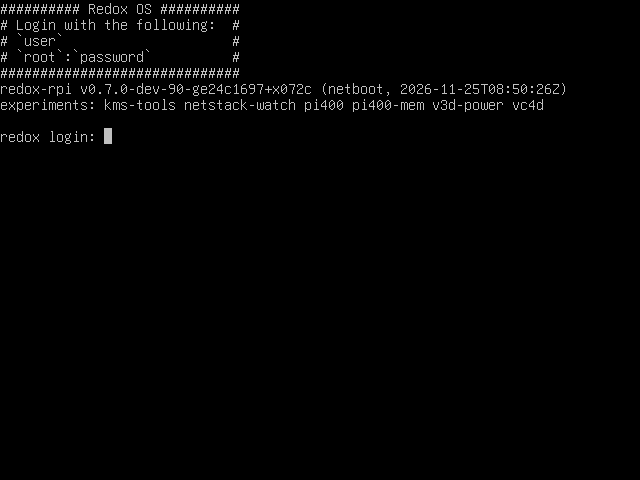

# Test 653 – libdrm's modetest against vc4d, second run (#728)

Date: 2026-11-25, 08:51–09:11 UTC. Pi test agent. Pi 400, network boot, no person, Orbital not started. config.txt as in Test 604 (`hdmi_force_hotplug=1`, `hdmi_drive=2`, no `total_mem=1024`), restored afterwards. vc4d took over channel 1 at 640x480. Image `keep/kms2-netboot/` `v0.7.0-dev-90-ge24c1697+x072c`: img.gz sha256 `4edf5f40e3e08857…` and manifest `e9cd8dc255bb266d…` both match the row. All commands ran as root on the serial console. `vc4shot` was run over devsh.

Result: **pass (all five steps run and copied, and `/dev/dri` gets no new files). The libdrm open fix works. `modetest` sets the mode without error, but no picture of it reaches the screen:**
- **libdrm opens the device now:** modetest, proptest, `modetest` with no argument and drmdevice all open `/dev/dri/card0` and list vc4d's objects.
- **`/dev/dri` stays clean:** only the `card0` link afterwards. There is no `renderD128`; the row expected one.
- **Modeset:** `setting mode 640x480-60.00Hz on connectors 27, crtc 22`, then it waits for Enter, rc 0. But the screen keeps the console: **inputd answers `switch to non-existent VT #7 was requested`** to `inputd -A 7`, even while modetest holds `/dev/dri/card0` open (pass C).
- **Page flips:** `failed to page flip: Invalid argument`, no flip rate.
- **Planes:** `no unused plane available for CRTC 22` with overlay 23.
- No crash, no reset, no panic.

Three boots of the same image:
- **A:** the row as written.
- **B:** step 5 again with the `-P` argument in quotes. In A, Ion read `@22` as a variable: `ion: expansion error: Variable "22" does not exist`.
- **C:** steps 3–5 again, with `inputd -A 7` sent over devsh *while* modetest waited. In A and B the switch came before modetest and inputd had no VT 7.

## Step 1 – `ls -l /dev/dri`, `drm_info` (A)

- `ls -l /dev/dri`: `card0 -> /scheme/display.vc4/7` only.
- `drm_info`, rc 0: the same as Test 652 pass 4, with the same two warnings first (`drmGetDevice: Invalid argument`, `drmModeGetPropertyBlob: No such file or directory`).
  - vc4d 1.4.0, connector 27 connected at 640×480, encoder 26, CRTC 22.
  - Planes 20 (Primary, FB 29), 21 (Cursor), 23, 24 and 25 (Overlay), all AR24 only.
  - Full output in [a/s12-clean.txt](653/a/s12-clean.txt).

## Step 2 (A)

| Command | Result | rc |
|---|---|---|
| `modetest -D /dev/dri/card0` | `opened device 'VideoCore IV HVS' on driver 'vc4d' (version 1.4.0 at 0)` and full lists (below) | 0 |
| `proptest -D /dev/dri/card0` | opened; properties of connector 27 (EDID, DPMS, TILE, CRTC_ID = 22) and CRTC 22 (ACTIVE = 1, GAMMA_LUT_SIZE = 1024) | 0 |
| `modetest` (no arguments) | `trying to open device '/dev/dri/card0'... done`, opened, same lists | 0 |
| `drmdevice` | `Devices reported 1`, `nodes[0] /dev/dri/card0`, bustype 0000, PCI ids 0000; then `Opening device node /dev/dri/card0`, `Retrieving device info, for node /dev/dri/card0` and it ends | 0 |
| `ls -l /dev/dri` afterwards | `card0 -> /scheme/display.vc4/7` only. **No new files** ✔; no `renderD128` | |

modetest's lists:
- **Encoders:** 26, type none, possible crtcs 0x1.
- **Connectors:** 27, connected, `Unknown-0`, 0×0 mm, 1 mode `640x480 60.00 640 640 640 640 480 480 480 480 18432`, preferred and driver. All h/v sync and total values equal the active size. Properties: EDID (empty blob), DPMS = On, TILE, CRTC_ID = 22.
- **CRTCs:** 22, fb 29, 640x480, ACTIVE = 1, GAMMA_LUT_SIZE = 1024.
- **Planes:**
  - 20 is on CRTC 22 with fb 29.
  - 21, 23, 24 and 25 have no CRTC and no fb.
  - All have possible crtcs 0x1 and formats `AR24` only.
- **Frame buffers:** 28 and 29, 640x480, pitch 2560.

## Steps 3–5 – modeset, page flips, planes

| Step | Command | Output | rc | Screen (`vc4shot`) |
|---|---|---|---|---|
| 3 (A, C) | `modetest -D /dev/dri/card0 -s 27:640x480` | opened; `setting mode 640x480-60.00Hz on connectors 27, crtc 22`; waits for Enter | 0 | console, no colour bars |
| 4 (A, C) | `… -s 27:640x480 -v` | opened; setting mode …; **`failed to page flip: Invalid argument`**; waits for Enter | 0 | console |
| 5 (B, C) | `… -s 27:640x480 -P '23@22:128x128'` | opened; setting mode …; **`no unused plane available for CRTC 22`** | 0 | console |
| 5 (A) | the same, unquoted | `ion: expansion error: Variable "22" does not exist` (Ion syntax, not a test result) | | console |

- **The screen never changed.** All shots in A, B and C show the same 640×480 console with one plane on the HVS. In each boot the plane address stayed at the console's buffer; in A, `bus 3256123392`, list 2176. vc4d logged nothing during the modesets.
- **Why, as far as I can see:** every `inputd -A 7` in all three boots logs `[@inputd:143 WARN] switch to non-existent VT #7 was requested`. That includes pass C, where modetest had `/dev/dri/card0` open and had set the mode. So VT 7 never exists for inputd, and vc4d keeps showing VT 2. Whether modetest's dumb buffer would show on a real VT 7 cannot be seen yet.
- **Step 5:** modetest's `-P` uses XR24 by default, while vc4d's planes offer only AR24. That may be why it finds no plane. `-P 23@22:128x128@AR24` would tell. I did not run it.
- rc 0 in steps 3–5 is the exit code of the empty Enter line, not of modetest itself.
- The NanoKVM was not used. `vc4shot` reads what vc4d scans out.

## Errors and restore

- No program hung or crashed. No reboot after login, `panic`/`UNHANDLED` 0 in all three boots, devsh still answered.
- Afterwards:
  - config.txt restored (byte-identical).
  - Row 501's image staged and booted to `redox login:` (09:11).

Files: [653/a/](653/a/) (steps 1–5 as written, shots, boot log), [653/b-step5/](653/b-step5/), [653/c-vt7/](653/c-vt7/).
